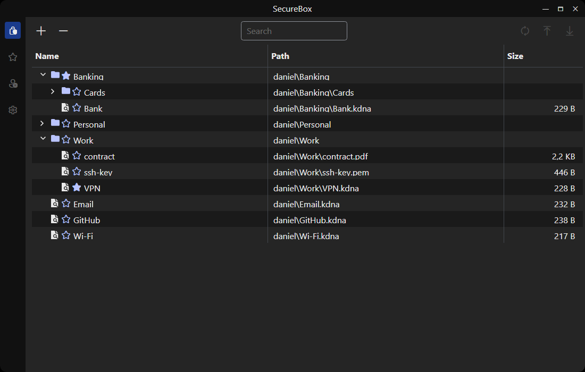
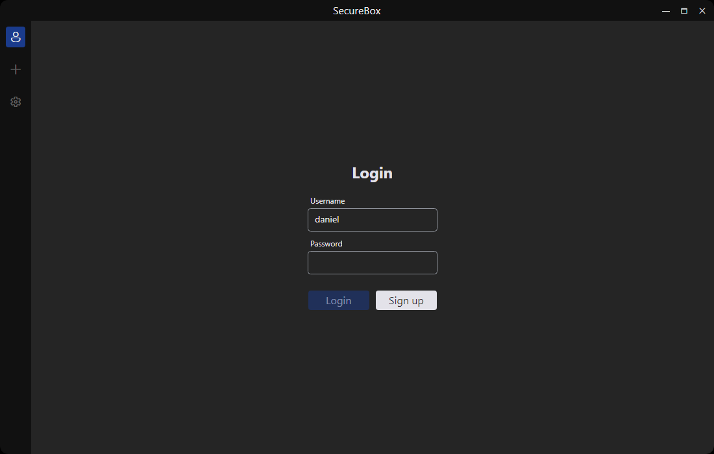
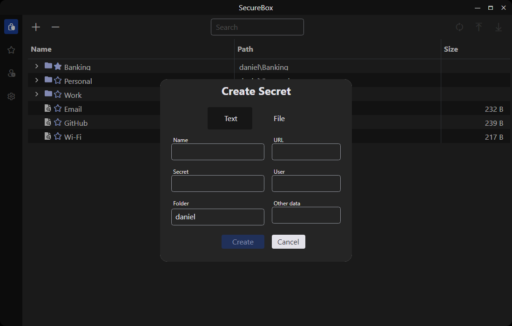
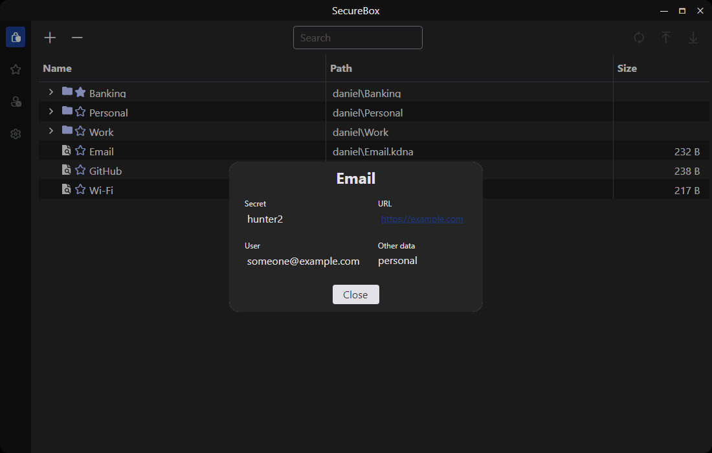
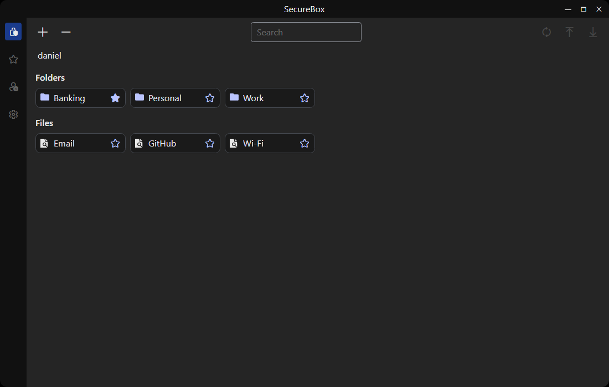
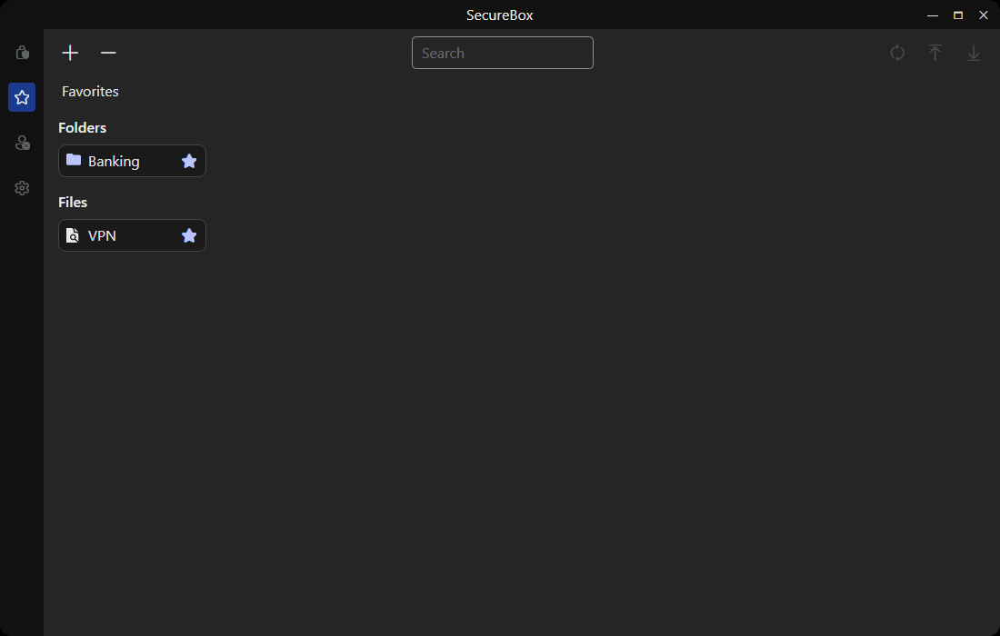
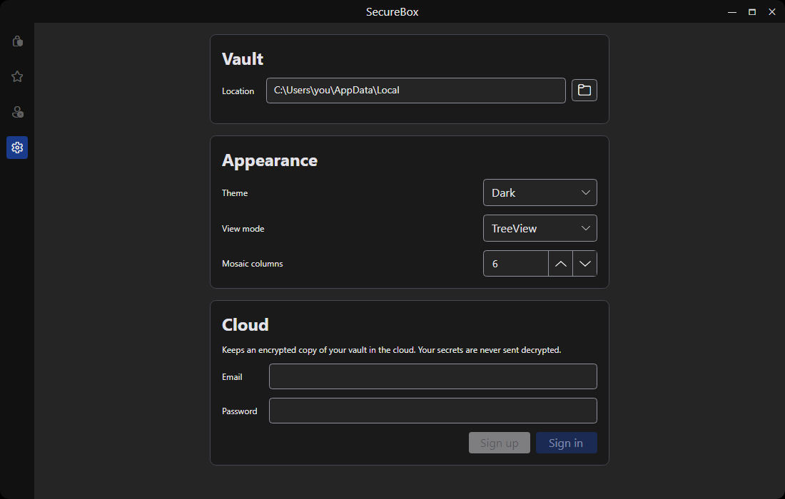
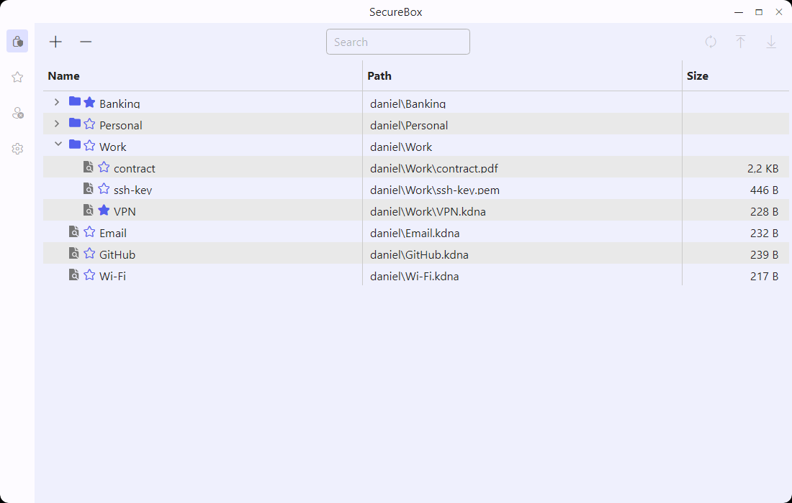
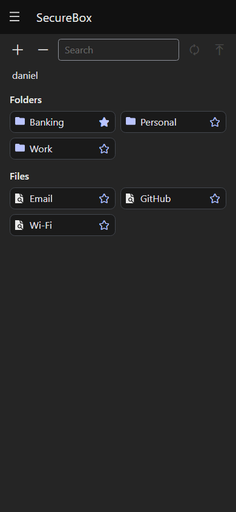

# SecureBox

An encrypted vault for your passwords, notes and files. Everything you put in SecureBox is
encrypted on your device with a key derived from your password, and only you can open it.
Optionally, you can keep an encrypted copy in the cloud and sync it between devices.



> [!NOTE]
> **About this README.** This guide was written by AI (Claude).
> **I have only tested the app on Windows and Android.** It also builds for macOS, Linux, iOS and
> the browser, but I have not tried those, so expect rough edges there.

## Features

- **Text secrets**: a password or note, with an optional URL, user name and extra notes.
- **Encrypted files**: any file, optionally compressed before it is encrypted. The original can be
  deleted once it is in the vault.
- **Folders** to organise your secrets, shown as a **tree** or as a **mosaic** of icons.
- **Favorites** for the secrets you open most.
- **Copy to clipboard** and **extract** a file back to disk when you need it.
- **Several users** on the same device, each with their own password and their own files.
- **Cloud copy** (optional): upload, download or sync your vault. Only encrypted files ever leave
  your device.
- **Light and dark theme.**

## Getting started

You need the [.NET 10 SDK](https://dotnet.microsoft.com/download). Then, from this folder:

### Windows

```bash
dotnet run --project SecureBox.Desktop
```

### Android

Install the Android workload once:

```bash
dotnet workload install android
```

Connect your phone with USB debugging enabled, then:

```bash
dotnet build SecureBox.Android -t:Install
```

## How it works



1. **Sign up** with a user name and a password. This creates your user on this device.
2. **Log in** with the same user name and password every time you open the app.
3. Press **Add** to create a secret or encrypt a file, and pick the folder it goes in.
4. Double-click (or tap) a secret to open it. From there you can copy its fields or extract the
   file.

> [!WARNING]
> **There is no password recovery.** Your password is the only way to decrypt your secrets. If you
> forget it, the data in the vault cannot be opened by anyone, including you.

### Creating a secret



| Type | Fields | Notes |
|---|---|---|
| **Secret** | Name, Secret, Folder, URL, User, Other data | For passwords, PINs, notes… |
| **File** | File, Name, Folder, Other data, Compress, Delete origin file | For documents, photos, keys… |

**Compress** makes large text-like files (documents, logs) smaller in the vault. It does little for
files that are already compressed, such as photos or ZIP files.

### Opening a secret



Text secrets show their fields, which you can copy. Files show their original name and an
**Extract** button that saves a decrypted copy wherever you choose.

## The screens

### Secrets

All your secrets and folders. Add, remove, open, and upload/download/sync with the cloud. Choose
between a **tree** with path and size (shown at the top of this page) or a **mosaic** you browse
folder by folder:



### Favorites

Only the secrets and folders you starred. Click the star on any item to add or remove it.



### Settings

Vault location, theme, view mode, mosaic columns and the cloud account.



### Light theme



### On a phone

On Android the side menu moves behind the ☰ button at the top.



## Cloud copy

The cloud copy is optional and off until you sign in to a cloud account in **Settings**. This
account is separate from your SecureBox user: it is an email and password used only for the cloud.

> [!NOTE]
> If you build SecureBox yourself, the cloud needs your own Firebase project. See *Firebase
> settings* in [TECHNICAL.md](TECHNICAL.md). Without it, everything else works.

Once signed in, the toolbar on the **Secrets** screen has three buttons:

| Button | What it does |
|---|---|
| **Upload** | Sends every file of your vault to the cloud. |
| **Download** | Writes the files in the cloud into your vault. |
| **Sync** | Upload, then download. |

- The files are sent **exactly as they are on disk, encrypted**. The cloud never sees your
  password or the content of your secrets.
- Nothing is deleted on either side. If a downloaded file has the same name as a different local
  file, both are kept and the new one is saved as `name (1)`.
- Files larger than about 700 KB cannot be stored in the cloud and are reported as failed.
- To open your secrets on another device, sign up there with the **same user name and password**,
  sign in to the same cloud account and press **Download**.

## Where your data is stored

| Device | Location |
|---|---|
| Windows | `%LOCALAPPDATA%\SecureBox` (you can choose another folder in **Settings**) |
| Android | Inside the app's private storage (removed if you uninstall the app, so upload a copy first) |

Settings are kept separately, in `%LOCALAPPDATA%\SecureVault\config.json` on Windows.

> [!CAUTION]
> Deleting a secret on Windows sends it to the Recycle Bin. It is still encrypted there, but empty
> the bin if you want it gone.

## For developers

Project structure, architecture and build notes are in [TECHNICAL.md](TECHNICAL.md).

## License

[MIT](LICENSE.txt)
